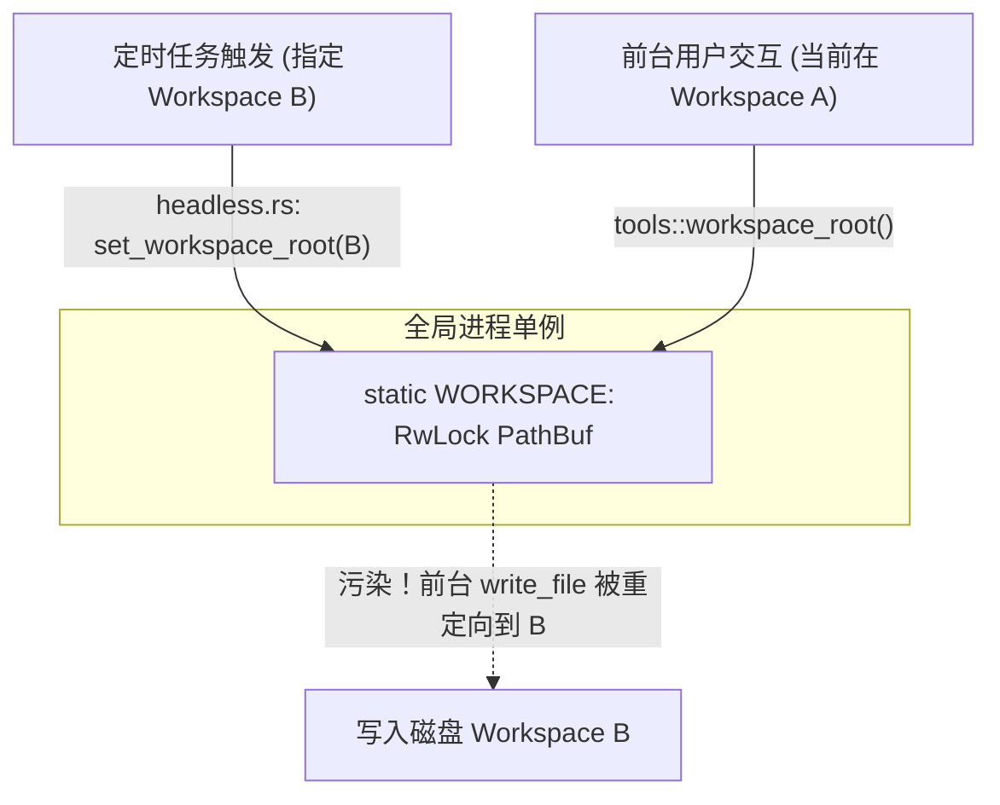

# Agent 项目全景体检与缺陷审计报告 (v0.32.0)

> **审计基线**：Commit [`8e48f95`](file:///c:/Users/31144/Desktop/agent-copy) (P2 拆分收口阶段，v0.32.0)  
> **审计原则**：只读检查（只看不动），深度覆盖 Rust 后端、Svelte 前端、Win32 底层沙箱机制、多模型协议、测试与工程打包。

---

## 一、 缺陷与不足全览矩阵 (Severity Matrix)

| 编号 | 类别 | 级别 | 缺陷标题 | 核心位置 | 影响面 |
| :--- | :--- | :---: | :--- | :--- | :--- |
| **01** | 前端交互 | **P0 严重** | 设置弹窗 MCP 页签完全白屏不渲染 | [`web/src/App.svelte#L4904`](file:///c:/Users/31144/Desktop/agent-copy/web/src/App.svelte#L4904) | 用户无法查看与配置任何 MCP 服务 |
| **02** | 前端状态 | **P0 严重** | 定时任务页签响应式声明放置错误失效 | [`web/src/lib/ScheduleTab.svelte#L214`](file:///c:/Users/31144/Desktop/agent-copy/web/src/lib/ScheduleTab.svelte#L214) | 切换到定时页签时无法自动拉取列表 |
| **03** | 测试工程 | **P0 严重** | 全局环境变量污染引发多线程测试偶发失败 | [`src/gateway/tests.rs#L278`](file:///c:/Users/31144/Desktop/agent-copy/src/gateway/tests.rs#L278) | `cargo test` 并发测试偶发红灯 (`127.0.0.1:1` 拒绝) |
| **04** | 协议适配 | **P1 高危** | Anthropic 适配器不支持多模态图片输入 | [`src/gateway/anthropic.rs#L159`](file:///c:/Users/31144/Desktop/agent-copy/src/gateway/anthropic.rs#L159) | Claude 渠道带图请求触发 400 报错 |
| **05** | 核心架构 | **P1 高危** | 工作区全局单例导致定时任务与前台交互互串 | [`src/tools/mod.rs#L38`](file:///c:/Users/31144/Desktop/agent-copy/src/tools/mod.rs#L38) | 定时任务运行期间前台对话文件操作跑偏 |
| **06** | 安全边界 | **P1 高危** | 路径校验存在“先创建目录后越界拦截”副作用 | [`src/tools/mod.rs#L380`](file:///c:/Users/31144/Desktop/agent-copy/src/tools/mod.rs#L380) | 越界写入时会在工作区外部残留创建目录 |
| **07** | 异步生命期 | **P2 中危** | SSE 断开后后台协程无感知持续空转 | [`src/server/chat/mod.rs#L230`](file:///c:/Users/31144/Desktop/agent-copy/src/server/chat/mod.rs#L230) | 关闭网页后后台继续消耗 Token 费用与磁盘写 |
| **08** | 系统健壮性 | **P2 中危** | Win32 进程拉起失败未清理句柄 & 挂起僵尸 | [`src/sandbox/proc.rs#L153`](file:///c:/Users/31144/Desktop/agent-copy/src/sandbox/proc.rs#L153) | 异常分支泄露 Win32 句柄，严重时残留挂起进程 |
| **09** | 资源管理 | **P2 中危** | MCP stdio 子进程未挂载 Job Object 导致孤儿进程 | [`src/mcp/mod.rs#L98`](file:///c:/Users/31144/Desktop/agent-copy/src/mcp/mod.rs#L98) | 服务重启或异常崩溃后遗留深层 node 孤儿子进程 |
| **10** | 异步效率 | **P2 中危** | 审批等待使用 100ms 忙轮询且客户端离线硬卡 120s | [`src/server/gate.rs#L161`](file:///c:/Users/31144/Desktop/agent-copy/src/server/gate.rs#L161) | 浪费 CPU 唤醒且关闭网页后审批通道长时间被占 |
| **11** | 安全防护 | **P2 中危** | 存储层未过滤 Windows 传统 DOS 预留设备名 | [`src/storage.rs#L48`](file:///c:/Users/31144/Desktop/agent-copy/src/storage.rs#L48) | 特殊键名 (`CON`, `NUL`) 触发 Win32 设备重定向异常 |
| **12** | 网络安全 | **P2 中危** | SSRF 预检在重定向域名解析场景存在盲区 | [`src/tools/web.rs#L84`](file:///c:/Users/31144/Desktop/agent-copy/src/tools/web.rs#L84) | 公网域名重定向至本地解析域名可绕过内网拦截 |
| **13** | 性能瓶颈 | **P3 优化** | 模型流式分片日志在 Tokio 协程中同步 Flush 盘 | [`src/gateway/openai.rs#L223`](file:///c:/Users/31144/Desktop/agent-copy/src/gateway/openai.rs#L223) | 高频输出时同步磁盘 I/O 阻塞 Tokio 事件循环 |
| **14** | 工程分发 | **P3 优化** | 发布打包脚本遗漏预置技能并保留已废弃目录 | [`scripts/package_release.ps1#L78`](file:///c:/Users/31144/Desktop/agent-copy/scripts/package_release.ps1#L78) | Release 包缺失 `skills/`，且带已删 `ui-ext` 警告 |
| **15** | 桌面端 | **P3 优化** | 桌面壳寻找服务端二进制依赖编译期宏路径 | [`desktop/src/main.rs#L95`](file:///c:/Users/31144/Desktop/agent-copy/desktop/src/main.rs#L95) | 独立打包分发或移动目录后桌面壳无法自启服务端 |
| **16** | 代码维护 | **P3 优化** | 前端 7400+ 行巨石文件且欠缺类型与 Lint 工具链 | [`web/src/App.svelte`](file:///c:/Users/31144/Desktop/agent-copy/web/src/App.svelte) | 代码耦合度极高，重构时易产生低级漏参/错位回归 |

---

## 二、 关键缺陷深度剖析与修复指引

### 1. 前端设置弹窗 MCP 页签完全白屏 (P0)

#### 根因剖析
在 P2 件 7/7 组件化重构中，`McpTab.svelte` 从 `App.svelte` 中剥离出来：
- 在 [`McpTab.svelte`](file:///c:/Users/31144/Desktop/agent-copy/web/src/lib/McpTab.svelte#L6) 中：
  ```svelte
  export let tab = '';
  ...
  {#if tab === 'mcp'}
    <!-- MCP 全部内容 -->
  {/if}
  ```
- 但在 [`App.svelte`](file:///c:/Users/31144/Desktop/agent-copy/web/src/App.svelte#L4904) 调用时：
  ```svelte
  <MemoryTab tab={settingsTab} on:openGalaxy={...} />
  <SkillsTab tab={settingsTab} skills={skillsData} loading={skillsLoading} on:reload={loadSkills} />
  <!-- 错误：漏传了 tab={settingsTab} -->
  <McpTab servers={mcpServers} on:action={(e) => mcpAction(e.detail.action, e.detail.name, e.detail.risk, e.detail.server)} />
  ```
  由于未传入 `tab`，组件内的 `tab` 恒为 `''`，`tab === 'mcp'` 恒为 `false`，整个组件在 DOM 中被完全卸载。

#### 修复指引
在 [`web/src/App.svelte#L4904`](file:///c:/Users/31144/Desktop/agent-copy/web/src/App.svelte#L4904) 补上 `tab={settingsTab}`：
```svelte
<McpTab tab={settingsTab} servers={mcpServers} on:action={(e) => mcpAction(e.detail.action, e.detail.name, e.detail.risk, e.detail.server)} />
```

---

### 2. 定时任务页签响应式声明放置错误 (P0)

#### 根因剖析
在 [`web/src/lib/ScheduleTab.svelte#L212-L215`](file:///c:/Users/31144/Desktop/agent-copy/web/src/lib/ScheduleTab.svelte#L212-L215)：
```javascript
  function fmtTs(ts) {
    if (!ts) return '—';
    const d = new Date(ts * 1000);
    const p = (n) => String(n).padStart(2, '0');
    return `${d.getFullYear()}-${p(d.getMonth() + 1)}-${p(d.getDate())} ${p(d.getHours())}:${p(d.getMinutes())}`;
  $: if (tab === 'schedule') loadSchedules(); // 放置在 fmtTs 闭合大括号之前！
  }
```
Svelte 编译报错：`$: has no effect outside of the top-level`。在函数内部，`$:` 仅被 JS 视为一个无意义的标签名（Label），完全失去了 Svelte 的响应式监听能力。

#### 修复指引
将 `$: if (tab === 'schedule') loadSchedules();` 移出 `fmtTs` 函数体，放在 `<script>` 的顶层作用域中。

---

### 3. 多线程单元测试并发环境变量污染导致测试偶发失败 (P0)

#### 根因剖析
- [`src/gateway/tests.rs#L278-L281`](file:///c:/Users/31144/Desktop/agent-copy/src/gateway/tests.rs#L278-L281) 测试代理重建逻辑：
  ```rust
  unsafe {
      std::env::set_var("HTTPS_PROXY", "http://127.0.0.1:1");
      std::env::set_var("HTTP_PROXY", "http://127.0.0.1:1");
  }
  ```
  此操作直接修改了整个测试进程的系统环境变量。
- 与此同时，[`src/mcp/oauth.rs#L642-L661`](file:///c:/Users/31144/Desktop/agent-copy/src/mcp/oauth.rs#L642-L661) 中的两个测试并发启动了本地 127.0.0.1 HTTP 回调服务，并用 `reqwest::get(&url)` 模拟浏览器请求。
- 默认的 `reqwest::get` 会自动读取系统的 `HTTP_PROXY`。一旦两个测试在多核并行执行中撞车，`oauth` 的环回请求被强行发往 `127.0.0.1:1`，直接报出 `ConnectionRefused` 导致断言 panic。

#### 修复指引
1. 在 [`src/mcp/oauth.rs`](file:///c:/Users/31144/Desktop/agent-copy/src/mcp/oauth.rs#L648) 测试中，使用显式带有 `.no_proxy()` 的专用客户端：
   ```rust
   let client = reqwest::Client::builder().no_proxy().build().unwrap();
   let body = client.get(&url).send().await.unwrap().text().await.unwrap();
   ```
2. 在跨模块篡改环境变量的测试上增加 `serial_test` 或共享互斥锁，避免破坏测试隔离性。

---

### 4. Anthropic Messages 协议多模态图片输入不兼容 (P1)

#### 根因剖析
- 在 [`src/server/chat/mod.rs#L298-L301`](file:///c:/Users/31144/Desktop/agent-copy/src/server/chat/mod.rs#L298-L301) 中，图片附件以 OpenAI 格式压入会话：
  ```rust
  parts.push(json!({
      "type": "image_url",
      "image_url": { "url": att.data_url() }
  }));
  ```
- 在 [`src/gateway/anthropic.rs#L159-L167`](file:///c:/Users/31144/Desktop/agent-copy/src/gateway/anthropic.rs#L159-L167) 组装请求体时：
  ```rust
  // user：content 原样透传（string 或多模态数组）
  _ => {
      let content = match m.get("content") {
          Some(Value::String(s)) => json!(s),
          Some(v) if !v.is_null() => v.clone(),
          _ => json!(""),
      };
      out.push(json!({ "role": "user", "content": content }));
  }
  ```
  `anthropic.rs` 仅转换了 `system` 与 `tool_use/tool_result`，对 `user` 的 content 进行了浅克隆透传。Anthropic Messages API 不支持 `image_url`，要求：
  ```json
  {
    "type": "image",
    "source": {
      "type": "base64",
      "media_type": "image/jpeg",
      "data": "..."
    }
  }
  ```

#### 修复指引
在 [`src/gateway/anthropic.rs`](file:///c:/Users/31144/Desktop/agent-copy/src/gateway/anthropic.rs) 增加一个多模态块转换函数：当遇到 `type == "image_url"` 时，从 data-url 解析出 `media_type` 与 `base64` 内容，重构为 Anthropic 原生的 `source` 结构块。

---

### 5. 全局工作区设计引发并发/定时任务执行互串 (P1)



#### 根因剖析
- [`src/tools/mod.rs#L38`](file:///c:/Users/31144/Desktop/agent-copy/src/tools/mod.rs#L38) 将工作区定义为全局单例：
  ```rust
  static WORKSPACE: OnceLock<RwLock<PathBuf>> = OnceLock::new();
  ```
- [`src/server/headless.rs#L332`](file:///c:/Users/31144/Desktop/agent-copy/src/server/headless.rs#L332) 中，当定时任务运行且指定了目录时，使用 `WorkspaceGuard` 临时修改全局 `tools::set_workspace_root(&p)`。
- 这意味着：在定时任务执行的几分钟内，全局工作区被切换为 B。此时任何并发的无头任务、子代理或前台用户发起的普通任务调用文件/git工具，都会**被引导至工作区 B**，极易误删、误改、误提交其他项目的代码。同时 `AppState.memory` 未同步切换，日志流水落入错误目录。

#### 修复指引
将工作区路径从全局静态变量收归为任务上下文显式传递：
1. 扩展 `ExecConfig`，增加 `workspace_root: PathBuf` 字段；
2. 工具函数（`read_file`, `write_file`, `shell`, `git`）全部从传入的 `ExecConfig` 获取工作区路径，彻底废除全局静态 `WORKSPACE`。

---

### 6. 工作区路径校验“先建目录后拦截”的安全缺陷 (P1)

#### 根因剖析
在 [`src/tools/mod.rs#L380-L388`](file:///c:/Users/31144/Desktop/agent-copy/src/tools/mod.rs#L380-L388) (`resolve_in_workspace`)：
```rust
} else {
    // 目标可能还不存在：先确保父目录存在，再对父目录做穿越校验
    let parent = full.parent().ok_or("路径无父目录")?.to_path_buf();
    std::fs::create_dir_all(&parent).map_err(|e| format!("创建父目录失败: {e}"))?; // <-- 先在真实磁盘上创建！
    let canon_parent = parent.canonicalize().map_err(|e| format!("父目录解析失败: {e}"))?;
    if !unconfined && !canon_parent.starts_with(&root) { // <-- 随后才检查是否越界！
        return Err(format!("拒绝访问工作目录外的路径: {rel}"));
    }
    Ok(canon_parent.join(full.file_name().ok_or("路径无文件名")?))
}
```
如果模型尝试越界写入（例如 `path = "../../evil_dir/payload.txt"`），代码会**先执行 `create_dir_all` 在工作区外部创建目录**，随后虽然报错拒绝了写文件，但外部目录已经切实残留。

#### 修复指引
路径规范化校验必须先于磁盘副作用：
通过逐级检查或已存在的祖先目录解析规范化路径，确认最终父目录归属于 `root` 后，再调用 `create_dir_all`。

---

### 7. SSE 客户端断开后后台协程无感知空转 (P2)

#### 根因剖析
在 [`src/server/chat/mod.rs#L230-L232`](file:///c:/Users/31144/Desktop/agent-copy/src/server/chat/mod.rs#L230-L232)：
```rust
let send = |payload: Value| {
    let _ = tx.send(Ok(json_event(payload)));
};
```
当用户关闭浏览器标签页或网络断开时，Axum 的 SSE 连接关闭，`rx` 被丢弃。然而后端的 `tokio::spawn` 协程内的 `send` 闭包直接 `let _ = tx.send(...)` 吞掉了通道关闭错误，且未检测 `tx.is_closed()`。

#### 影响与修复指引
用户关掉页面后，大模型仍在后台执行多步决策与工具调用，不仅浪费用户 API Token，还会擅自修改文件。
**修复**：在循环每个决策点及 `send` 闭包中检测通道状态，一旦 `tx.is_closed()` 成立，立即触发取消并退出任务协程。

---

### 8. Win32 沙箱进程创建失败句柄泄漏与挂起僵尸进程 (P2)

#### 根因剖析
在 [`src/sandbox/proc.rs#L101-L167`](file:///c:/Users/31144/Desktop/agent-copy/src/sandbox/proc.rs#L101-L167)：
1. 错误清理不完整：若 `CreateProcessAsUserW` 失败（第 153 行），仅关闭了 `out_r` 和 `err_r`，前面打开的 `out_w`、`err_w` 和 `nul` 句柄均发生泄漏。
2. 挂起进程残留：
   ```rust
   job.assign(pi.hProcess)?; // <-- 若此处失败并提前 ? 返回！
   ResumeThread(pi.hThread);
   CloseHandle(pi.hThread);
   ```
   以 `CREATE_SUSPENDED` 启动的子进程并未绑定到 Job Object，线程也未恢复，若 `job.assign` 报错，由于缺少 RAII 守卫或 `TerminateProcess` 兜底，该挂起进程及其句柄将永久作为不可被杀死的僵尸进程遗留在系统内核中。

#### 修复指引
将原始 Win32 `HANDLE` 包装在带有 `Drop`（自动调用 `CloseHandle`）的 RAII 结构体内；并在 `assign` 失败时显式调用 `TerminateProcess(pi.hProcess, 1)`。

---

### 9. MCP stdio 进程缺乏 Job Object 保险丝 (P2)

#### 根因剖析
在 [`src/mcp/mod.rs`](file:///c:/Users/31144/Desktop/agent-copy/src/mcp/mod.rs) 中，启动 stdio 类型的 MCP Server 仅使用了标准库的 `std::process::Command`，未像执行沙箱或内置浏览器一样将其进程树纳入带 `JOB_OBJECT_LIMIT_KILL_ON_JOB_CLOSE` 的 Job Object。
当 Agent 进程意外退出（例如崩溃或通过任务管理器杀进程）时，由 `cmd /c npx ...` 派生的深层 `node.exe` 进程脱离父进程，长期驻留并占用端口与内存。

#### 修复指引
复用 `src/sandbox/job.rs` 中的 `JobGuard`，在拉起 MCP stdio 子进程后将其放入独立的 Job Object 中，确保主进程退出时整个进程树被强制清理。

---

### 10. 审批门等待轮询与离线卡死 (P2)

#### 根因剖析
在 [`src/server/gate.rs#L161-L186`](file:///c:/Users/31144/Desktop/agent-copy/src/server/gate.rs#L161-L186)：
- `CancelFlag` 已具备事件通知能力 `flag.cancelled().await`，但在 `gate.rs` 中等待取消依然手写了 `loop { sleep(100ms) }` 轮询。
- 审批等待超时固定为 120 秒，若用户在弹窗出现后直接关闭页面，`select!` 分支中缺少 `tx.is_closed()` 监听，会导致该审批通道在后台硬卡死等满 120 秒。

#### 修复指引
改用 `flag.cancelled().await` 替代 `wait_cancelled`；并在 `tokio::select!` 中加入客户端断开通道检测，断开即视为拒绝并立即返回。

---

### 11. 插件存储层未过滤 Windows 保留设备名 (P2)

#### 根因剖析
在 [`src/storage.rs#L48-L65`](file:///c:/Users/31144/Desktop/agent-copy/src/storage.rs#L48-L65)：
`safe_plugin_name` 和 `safe_key` 仅验证了字符集和长度，但未过滤 Windows 传统保留设备名（`CON`, `PRN`, `AUX`, `NUL`, `COM1`~`COM9`, `LPT1`~`LPT9`）。
若传入类似 `plugin_data/CON/test.json`，在 Windows 下会发生控制台重定向异常，导致文件 I/O 阻塞或底层崩溃。

#### 修复指引
在 `safe_plugin_name` 与 `safe_key` 校验中，加入 DOS 保留设备名称黑名单匹配（不区分大小写）。

---

### 12. 模型流式分片日志在 Tokio 线程中同步 Flush (P3)

#### 根因剖析
在 [`src/gateway/openai.rs#L223`](file:///c:/Users/31144/Desktop/agent-copy/src/gateway/openai.rs#L223) 中，每当收到一个 SSE 数据块：
```rust
observability::event(EventType::ModelChunk, payload);
```
该函数内部获取全局互斥锁并立即调用 `f.flush()`。一次 2000 token 的流式生成，将直接在 Tokio 异步工作线程上连续引发数千次同步磁盘 I/O 刷盘，大幅拉高调度抖动与响应延迟。

#### 修复指引
将日志系统重构为“异步通道发送 + 后台独立线程批量写入（带定时/按大小 Flush）”模式，彻底解放 Tokio 工作线程。

---

### 13. 打包发布脚本缺陷 (P3)

#### 根因剖析
在 [`scripts/package_release.ps1#L78`](file:///c:/Users/31144/Desktop/agent-copy/scripts/package_release.ps1#L78)：
```powershell
foreach ($dir in @("prompts", "plugins", "ui-ext")) {
    $p = Join-Path $root $dir
    if (Test-Path $p) { Copy-Item $p (Join-Path $out $dir) -Recurse -Force }
}
```
1. `ui-ext` 早已在 P28 中并入 `plugins/`，此处仍试图复制已不存在的目录。
2. 根目录下的 `skills/`（包含内置的 `browser-use`、`git-commit` 等）**被遗漏未打包**，导致发布给用户的独立包中技能完全为空。
3. 桌面壳未纳入一键发布流程。

#### 修复指引
将复制列表更新为 `@("prompts", "plugins", "skills")`，并按需增加桌面壳构建打包开关。

---

### 14. 桌面壳主执行文件路径探测固化 (P3)

#### 根因剖析
在 [`desktop/src/main.rs#L95-L104`](file:///c:/Users/31144/Desktop/agent-copy/desktop/src/main.rs#L95-L104)：
寻找 `agent.exe` 依赖了编译期宏 `PathBuf::from(env!("CARGO_MANIFEST_DIR"))`。一旦打包成 release 并在其他机器或移动后的目录运行，该路径不存在，且代码未回退到当前 exe 所在同级目录（`current_exe().parent()`），导致桌面壳报告找不到服务端而无法启动。

#### 修复指引
优先探测 `std::env::current_exe()?.parent().join("agent.exe")`，未命中时再回退到开发期路径。

---

### 15. 前端单文件巨石与工程化工具缺失 (P3)

#### 根因剖析
- [`web/src/App.svelte`](file:///c:/Users/31144/Desktop/agent-copy/web/src/App.svelte) 依然包含 **7,434 行**代码，所有输入框、消息气泡流式补全、多会话切换、侧边栏拖拽等状态高度耦合。
- `web/package.json` 中仅有 `svelte` 与 `vite`，**未引入 TypeScript、ESLint 或 `svelte-check`**。
上述的 `McpTab` 漏传参数、`ScheduleTab` 标签错位等问题，本应在编译或静态代码扫描阶段就被工具直接拦截，由于缺少前端静态检查链，全部直接穿透到了运行时。

#### 修复指引
在 `web` 项目中引入 `svelte-check` 与 ESLint，并在 CI 中作为阻断项加入流水线；将聊天消息流（MessageList/Bubble）与输入区（Composer）进一步抽离独立组件。

---

## 三、 架构演进与长期建议

1. **工作区多会话解耦 (Session-Scoped Workspace)**：
   目前架构限制了“同时只能在一个全局工作区操作”。建议在 `AppState` 或 `SessionContext` 中将 `workspace_root` 作为每条会话专属的属性，彻底消除单例竞争风险，为多工作区多子代理并行打下地基。
2. **连接生命周期贯通 (Cancellation Propagation)**：
   将 Axum 请求级取消 Token 与 `CancelRegistry` 深度打通，客户端断连即自动触发会话级 Cancel，杜绝任何形式的算力与资费泄漏。
3. **前端工程化加固 (Frontend Tooling Upgrade)**：
   为 Svelte 前端添加 `npm run check`，在提交前把低级模板语法和类型错位消灭在开发期。
